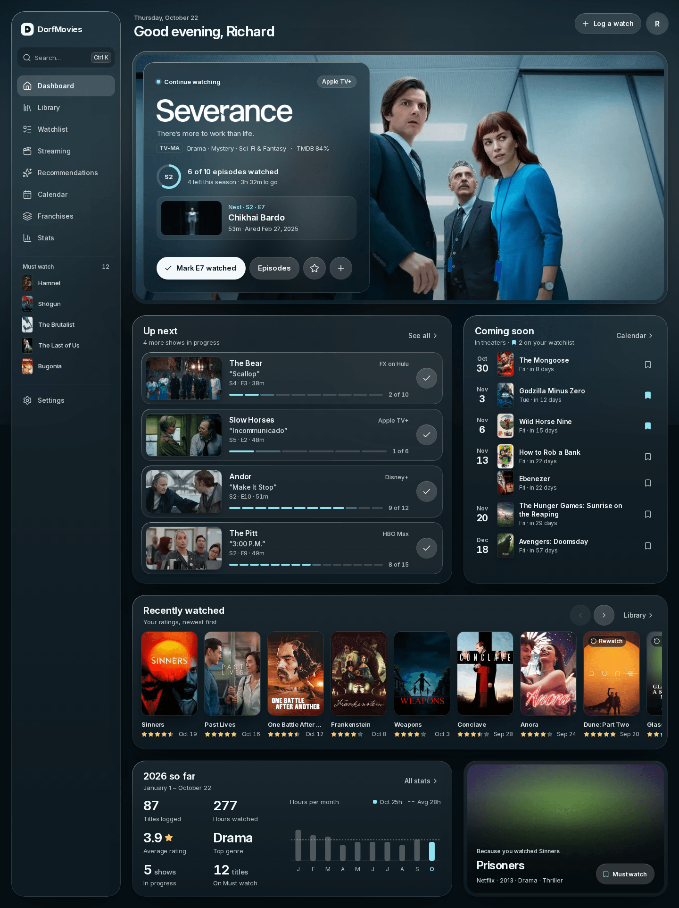
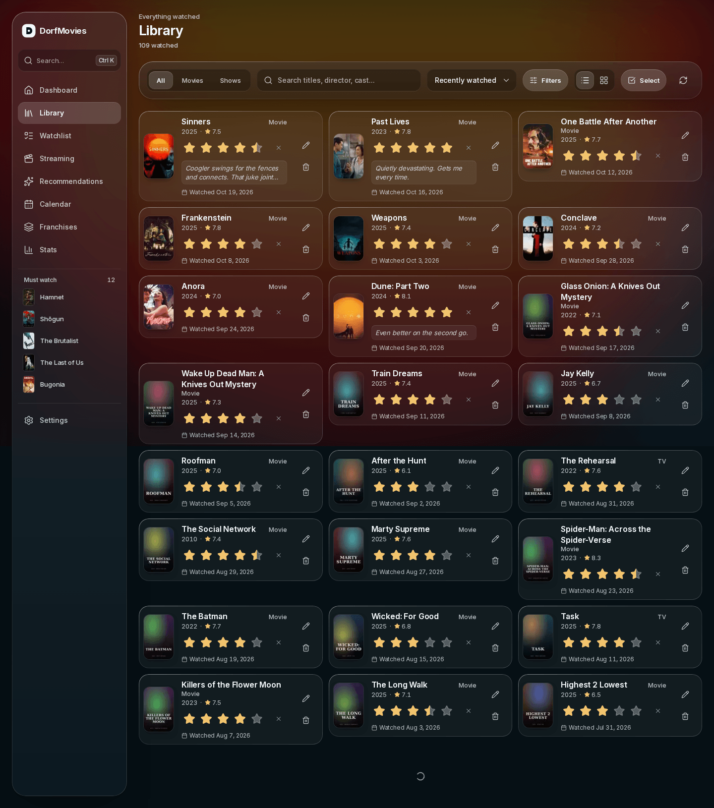
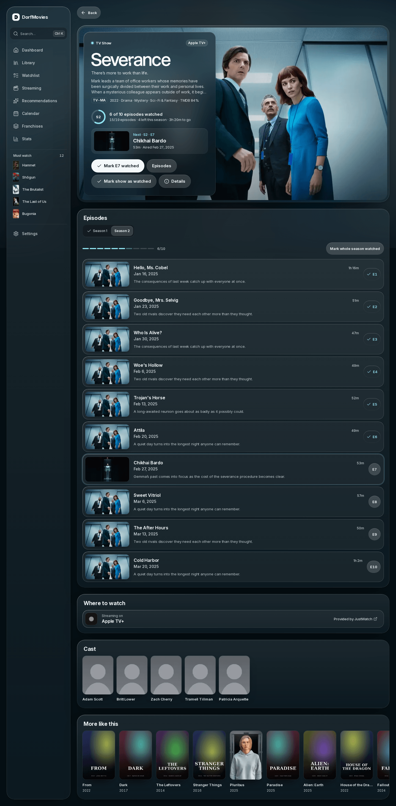
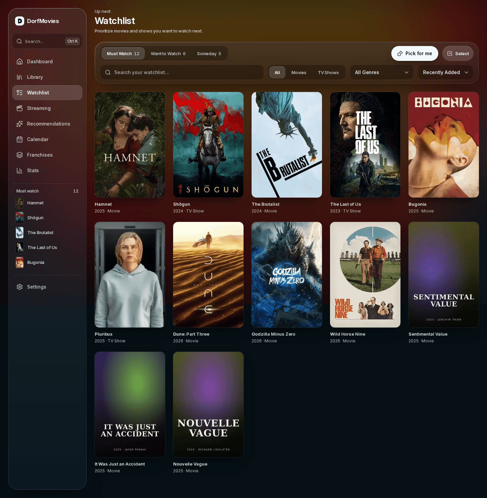
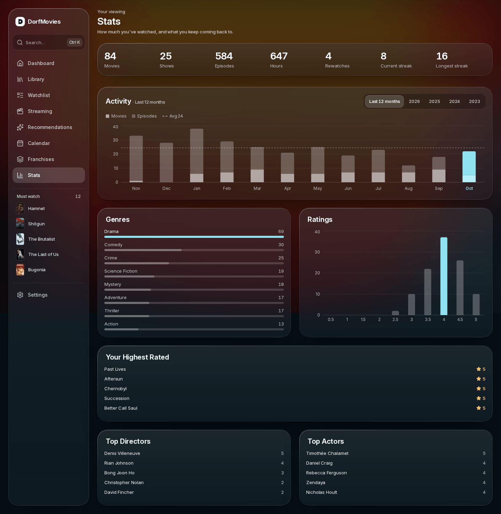

# DorfMovies

A personal movie and TV tracker. Log what you watch, rate it, keep a prioritised
watchlist, follow shows episode by episode, and see where the things you want to
watch are streaming — backed by your own Supabase project and TMDB metadata.

It is built as a **single-user, invite-only instance**. Every route except the
sign-in pages and the two share links sits behind Supabase auth, and signup is
disabled entirely unless you explicitly set an invite code.



---

## Features

**Tracking**
- Log movies and episodes with a 0–5 rating in half-star steps, a watch date and a review
- Per-season episode tracker, with undo on the destructive actions
- Rewatch support, so a second viewing does not overwrite the first
- "Continue watching" and "Up next" surfaced on the dashboard

**Finding things**
- `⌘K` / `Ctrl+K` search overlay with quick actions, across TMDB and your library
- Library with a grid/list toggle, type and genre filters, and filter state in the URL
- Multi-select for bulk actions
- Recommendations scored from what you have already watched
- "Tonight's pick" — one suggestion weighed across all three watchlist priorities

**Planning**
- Watchlist with three priorities: Must watch, Want to watch, Someday
- Streaming page: where each watchlist title is currently available
- Calendar of upcoming episodes and releases for shows you follow
- Franchises page grouping your library into TMDB collections

**Looking back**
- Stats: hours watched, genre breakdown, rating distribution, monthly and yearly
  activity, top directors and actors, streaks

**Sharing and data**
- Revocable share links for your watch history and your watchlist, served through
  token-gated `SECURITY DEFINER` RPCs. The pages are `noindex` and the token in
  the URL is the only key
- CSV import and export. The export escapes leading `=`, `+`, `-` and `@` so a
  title cannot become a spreadsheet formula

**The app itself**
- Installable as a PWA, with its own icons and manifest
- "Spatial Glass" design system: an ambient backdrop blurred from the artwork of
  whatever you are looking at, under layered glass panels

| Library | Show |
|---|---|
|  |  |

| Watchlist | Stats |
|---|---|
|  |  |

More screenshots, desktop and mobile, are in
[`docs/designs/spatial-glass/after/`](docs/designs/spatial-glass/after/).

---

## Stack

| | |
|---|---|
| Framework | Next.js 16.2.6, App Router, Turbopack |
| UI | React 19.2.4, TypeScript 5, Tailwind CSS 4 |
| Data | Supabase (Postgres + Auth, `@supabase/ssr`) |
| Metadata | TMDB API |
| Charts | Recharts |
| Icons | lucide-react |
| Tests | Vitest 4 + Testing Library, jsdom |
| Hosting | Vercel |

Auth is enforced in `proxy.ts` — Next 16's renamed middleware — using
`supabase.auth.getClaims()`, which verifies the token signature locally against a
cached JWKS instead of making a round trip per request. Enable **asymmetric JWT
signing keys** in your Supabase project, or it silently falls back to a network
call on every request. See the note in `lib/supabase/server.ts`.

---

## Prerequisites

- **Node.js 20.9 or newer** (CI builds on 22)
- **npm** — the repo ships a `package-lock.json`
- A **Supabase** project; the free tier is plenty
- A **TMDB API key** — <https://www.themoviedb.org/settings/api>

---

## Environment variables

```bash
cp .env.local.example .env.local
```

| Variable | Required | Scope | Purpose |
|---|---|---|---|
| `NEXT_PUBLIC_SUPABASE_URL` | yes | build + browser | Supabase project URL |
| `NEXT_PUBLIC_SUPABASE_ANON_KEY` | yes | build + browser | Supabase anon key. Public by design — every table is behind RLS |
| `TMDB_API_KEY` | yes | server only | TMDB v3 key. Without it every lookup returns empty results |
| `NEXT_PUBLIC_SITE_URL` | in production | build | Canonical origin. Becomes `metadataBase`, so Open Graph and Twitter image URLs resolve absolutely |
| `NEXT_PUBLIC_APP_URL` | no | build | Origin used for share links and the signup confirmation redirect. On Vercel it falls back to `VERCEL_PROJECT_PRODUCTION_URL`; locally set `http://localhost:3000` |
| `ADMIN_SECRET` | no | server only | Bearer token for `POST /api/admin/**`. **Leave it unset and those routes return 503** |
| `SIGNUP_INVITE_CODE` | no | server only | Gate on `/signup`. **Leave it unset and signup is disabled entirely.** This is the right setting for a single-user instance |
| `NEXT_PUBLIC_IPTV_URL` | no | build + browser | Base URL of a self-hosted IPTV search page. Unset hides the "Watch on IPTV" button |

> **`NEXT_PUBLIC_*` values are frozen at build time.** They are inlined into the
> client bundle, so on Vercel they must be set in **Project → Settings →
> Environment Variables before the deploy**, not after. Changing one later needs
> a rebuild.

---

## Database setup

Migrations live in [`supabase/migrations/`](supabase/migrations/), numbered
`001`–`014`. They are plain SQL and **must be applied in order**. They create the
schema, the row-level security policies, the share RPCs and the performance
indexes; the app does not work without them.

With the Supabase CLI:

```bash
supabase link --project-ref <your-project-ref>
supabase db push
```

Without it, open the Supabase dashboard → SQL Editor and run each file in numeric
order, oldest first.

The ones worth knowing about:

- `001_initial.sql` — media, seasons, watch entries, watchlist, user settings, RLS
- `006_share_rpcs.sql` — the token-gated `shared_watched` / `shared_watchlist`
  `SECURITY DEFINER` functions behind the share links
- `009_media_tmdb_type_unique.sql` — `(tmdb_id, type)` uniqueness, without which a
  movie and a show sharing a TMDB id collide
- `011_perf_and_security_audit.sql` — replaces a check-then-insert race with a
  partial unique index and hardens the share RPCs
- `014_media_art.sql` — adds `backdrop_url` and `logo_url` for the ambient layer

Rows written before `004` and `014` have a null `vote_average`, `backdrop_url` and
`logo_url`. Backfill them once with the admin endpoints below.

---

## Local development

```bash
npm install
npm run dev
```

Then open <http://localhost:3000>.

With `SIGNUP_INVITE_CODE` unset there is no way to create the first account from
the UI — that is deliberate. Create your user in the Supabase dashboard
(Authentication → Users → Add user), or set an invite code temporarily and use
`/signup`.

### Scripts

| Command | What it does |
|---|---|
| `npm run dev` | Dev server (Turbopack) |
| `npm run build` | Production build |
| `npm start` | Serve a production build |
| `npm run lint` | ESLint |
| `npm run typecheck` | `tsc --noEmit` |
| `npm test` | Vitest in watch mode |
| `npm run test:run` | Vitest once — what CI runs |

CI (`.github/workflows/ci.yml`) runs lint → typecheck → tests → build on every
push to `master` and every pull request.

### Admin backfills

One-off data repair jobs, all `POST`, all behind `ADMIN_SECRET`:

```bash
curl -X POST https://<host>/api/admin/backfill-vote-average \
  -H "Authorization: Bearer $ADMIN_SECRET" \
  -H "Cookie: <a signed-in session cookie>"
```

They need **both** the bearer secret and a logged-in Supabase session: `media`'s
update policy requires `auth.uid() is not null`, so a sessionless client writes
zero rows. Each is idempotent and resumable; the response says how much is left.

- `backfill-vote-average` — fills `media.vote_average` for pre-`004` rows
- `backfill-media-art` — fills `backdrop_url` / `logo_url` for pre-`014` rows
- `backfill-show-runtime` — fills `runtime_mins` for shows, so TV counts toward
  the stats page's Hours total
- `backfill-collections` — fills `collection_id` for movies

---

## Deployment

Deployed on Vercel at <https://dorfmovies.vercel.app>.

1. Import the repo into Vercel. The defaults are correct; no build command
   override is needed.
2. Set every variable from the table above in **Project → Settings → Environment
   Variables**, for Production *and* Preview, **before the first deploy**.
3. In Supabase → Authentication → URL Configuration, add your deployed origin
   plus `/auth/callback` to the redirect allow-list, or password-reset and
   confirmation emails bounce back to localhost.
4. In Supabase → Authentication → JWT, switch to asymmetric signing keys so
   `getClaims()` verifies tokens locally.
5. Apply the migrations against the production database.

Security headers (`X-Content-Type-Options`, `Referrer-Policy`, `X-Frame-Options`,
`Permissions-Policy`) are set for every route in `next.config.ts`, and
`next/image` is restricted to `image.tmdb.org/t/p/**`.

---

## Project layout

```
app/
  (app)/           authenticated routes — dashboard, library, watchlist, show,
                   stats, calendar, collections, streaming, settings
  (public)/        login, signup, password reset, and the two /share pages
  api/             route handlers (TMDB proxy, watch, watchlist, episodes,
                   import/export, admin backfills)
  styles/
    design-system/ vendored Spatial Glass tokens — what the build imports
components/        UI, split by surface (home/, title/, grid/, ui/)
lib/               Supabase clients, TMDB client, stats, validation, OG cards
supabase/
  migrations/      numbered SQL, applied in order
docs/              design specs, audits, before/after screenshots
proxy.ts           the auth gate (Next 16's renamed middleware)
```

---

## Conventions

**This is not the Next.js you may know.** Next 16 changed enough that training
data and older blog posts are actively misleading. Before touching an API, a file
convention or anything metadata-related, read the matching guide in
`node_modules/next/dist/docs/` — the full docs ship with the package. Start at
`index.md`, then `01-app/`. This is what `AGENTS.md` tells coding agents too.

House rules the codebase holds itself to:

- **Every mutating route goes through `lib/validation.ts`** — bounded text, real
  calendar dates, half-step ratings, UUID checks, and a `readJson` that returns
  400 on a malformed body rather than throwing a 500.
- **Secrets are compared hash-then-`timingSafeEqual`**, never with `===`.
- **Reads that can exceed PostgREST's 1000-row cap go through `fetchAllRows`.**
  A silent truncation shows saved titles as unsaved, which is worse than an error.
- **Comments explain _why_, not _what_.** Most non-obvious lines carry the reason
  they are that way. Keep that up.
- **Design tokens are edited in `.agents/skills/dorfmovies-design/` and copied
  into `app/styles/design-system/`.** The two must stay byte-identical —
  `app/styles/design-system/__tests__/designSystemSync.test.ts` fails the build if
  they drift.
- **Tests live next to what they test**, in a `__tests__/` folder.

---

## License

Private project; all rights reserved.
